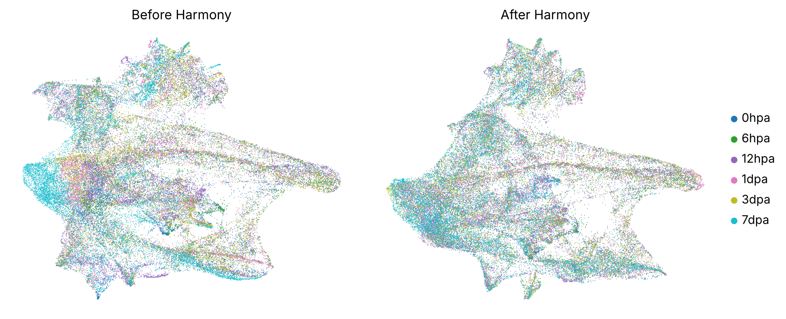
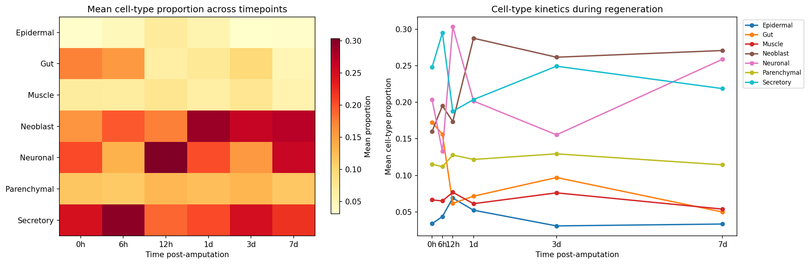
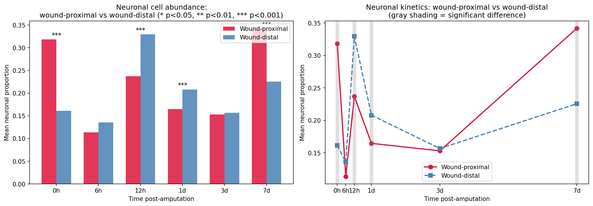
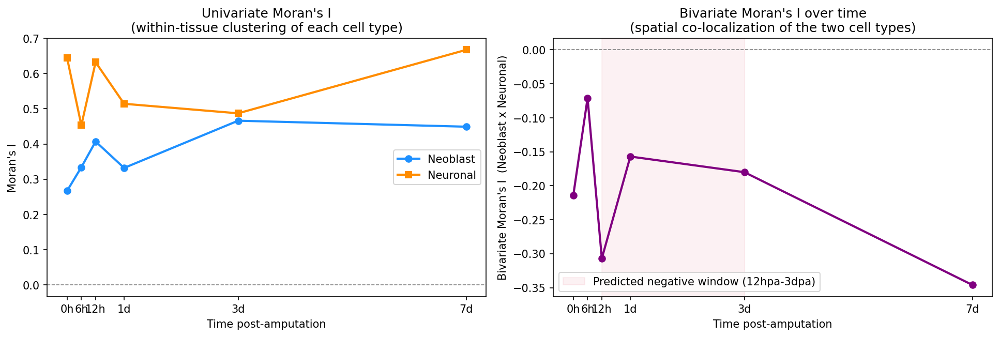
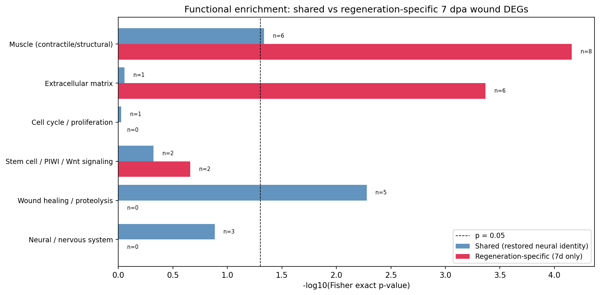

# Spatial dynamics of neural regeneration in planarians

Re-analysis of public Visium spatial transcriptomics data from a planarian regeneration time course (0 hpa to 7 dpa; [Cui et al., 2023](https://www.nature.com/articles/s41467-023-39016-0)). Starting from raw counts, the analysis follows tissue changes after amputation, narrows down to the nervous system, and tracks where neural tissue is lost, how it is rebuilt, and whether the rebuilt tissue is molecularly mature.

**Main finding:** neural tissue at the wound is spatially rebuilt by 7 dpa, but its gene expression has only partly returned to the uninjured state. Spatial completion comes before molecular completion.

## Background

Planarians can regrow any missing body part, including the entire brain, from adult pluripotent stem cells called neoblasts. Most of what is known about this comes from imaging single markers or from dissociated single cells, which lose tissue position. Spatial transcriptomics keeps both gene expression and position, so it can show where tissue is lost and rebuilt after an injury and in what order.

## Analysis overview

| Step | Analysis | Notebook |
|------|----------|----------|
| 1 | Quality control, normalization, batch correction, clustering, cell-type labels | `01_qc_integration_clustering.ipynb` |
| 2 | Cell-type dynamics across the time course | `02_analysis.ipynb` |
| 3 | Neural loss and recovery at the wound | `02_analysis.ipynb` |
| 4 | Spatial organization of regenerating neurons | `02_analysis.ipynb` |
| 5 | Molecular maturity of the regenerated tissue | `02_analysis.ipynb` |

## Results

### 1. Preprocessing and integration

All six timepoints are combined and processed together: QC, normalization, highly variable genes, PCA, Harmony batch correction (timepoint as batch), Leiden clustering, and preliminary cell-type labels from marker genes (`notebooks/01_qc_integration_clustering.ipynb`). Harmony removes the separation between timepoints seen in the uncorrected embedding.



### 2. Neurons are the most dynamic differentiated cell type

All seven cell types change over time; neurons follow a V-shaped trajectory (high at 12 hpa, lowest at 3 dpa, recovered by 7 dpa).



### 3. Neuronal loss and recovery are wound-specific

Neurons are depleted at the wound at 12 hpa and 1 dpa, then exceed wound-distal levels at 7 dpa (0.34 vs 0.23).



### 4. Neurons are rebuilt by a local burst followed by self-organization

Spatial statistics fit this model best. At 7 dpa, neurons are the most spatially clustered of the time course and most strongly separated from neoblasts.



### 5. The regenerated tissue is only partly mature

About 35% of the baseline wound-region gene signature is recovered at 7 dpa; genes specific to regeneration are enriched for muscle and extracellular matrix, not for cell cycle or stem-cell programs.



## Methods

- **Preprocessing:** QC (spots with ≥500 counts and ≥200 genes; genes in ≥10 spots), library-size normalization and log transform, 2,000 highly variable genes, 50-component PCA, Harmony batch correction, Leiden clustering (resolution 0.4), and marker-based labels using BLAST-mapped human orthologs.
- **Cell-type proportions:** cell2location estimates (provided with the dataset) divided by their per-spot sum.
- **Anatomical alignment:** pharynx center located from FOXA1-ortholog expression; wound-proximal spots defined by distance from the cut edges.
- **Statistics:** Kruskal-Wallis for cell-type dynamics; two-sided Mann-Whitney U for wound vs distal comparisons; Spearman correlation and univariate/bivariate Moran's I on a k-nearest-neighbor graph, with permutation tests and spatial block bootstrap, for spatial organization; Wilcoxon differential expression with Benjamini-Hochberg correction and Fisher's exact test for gene-set enrichment, for molecular maturity.
- **Gene annotation:** planarian (SMED) genes mapped to human gene symbols by BLAST best hit (`data/smed_blast.csv`, not included in this repository; see Data source).

## Limitations

- **No biological replicates.** One section per timepoint, so p-values reflect variation between spots within one section, not between animals.
- **Cell-type proportions are model estimates**, not direct measurements; biases in cell2location carry into every downstream result.
- **The wound mask changes meaning over time.** At 0 hpa it covers the intact head and tail tips, used here as an anatomical baseline.
- **Fixed thresholds** (wound distance, marker percentile) were not varied in a sensitivity analysis.
- **Ortholog mapping by BLAST best hit** is approximate, and planarian genes without a human match are excluded from enrichment analysis.

## How to run

```bash
uv sync
# put the .h5ad files in data/Scanpy_Visium/ (see data/README.md)
uv run jupyter lab
```

Run `notebooks/01_qc_integration_clustering.ipynb` first; it writes `data/processed/01_integrated.h5ad` (not tracked). `notebooks/02_analysis.ipynb` reads the raw files directly and can be run on its own. The notebooks also write their figures to `figures/`.

## Repository layout

```
notebooks/01_qc_integration_clustering.ipynb   QC, normalization, Harmony, clustering, labels
notebooks/02_analysis.ipynb                     cell-type dynamics, wound analysis, spatial statistics, maturity
docs/notes.md                                  background notes on methods (batch correction, Harmony)
data/                                          inputs (large files not tracked)
figures/                                       figures exported by the notebooks
```

## Data source

Cui et al., 2023, *Nature Communications*. Processed Visium data: OMIX003867. The SMED-to-human BLAST table (`data/smed_blast.csv`) is not included in this repository yet; it is needed to run the notebook.
